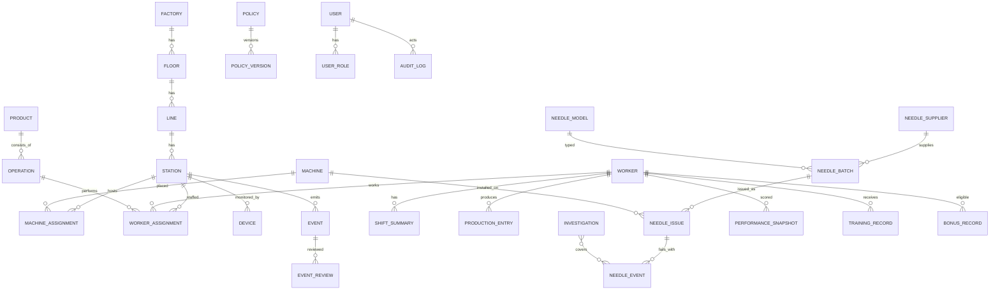

# Backend Design

**Status:** Draft v1 — 2026-11-17
**Stack:** FastAPI · SQLAlchemy 2 · Alembic · PostgreSQL 16 · Redis · Celery · MinIO
**Related:** [PRD](PRD.md) · [TRD](TRD.md) · [Flows](FLOWS.md)

---

## 1. Design principles

1. **Raw events are append-only.** Corrections are separate `event_reviews` rows. Derived tables (summaries, snapshots) can always be recomputed.
2. **Everything that changes over time is time-bound.** Assignments, machine placement, needle issues and policies all have `valid_from` / `valid_to`. Event attribution is a time-range lookup.
3. **Policies are versioned**, and every derived row stores the `policy_version_id` it used.
4. **Detected ≠ confirmed.** Production, needle and quality data keep source and review status.
5. **UTC in the DB**, factory time zone for display and shift-date logic.
6. **Single tenant per install.** No `tenant_id`; `factory_id` scopes data inside one client install.
7. **No hard-coded business values.** Machine types, brands, defect types, reason codes, alert rules, thresholds and counts of anything live in tables or policy versions. Code holds only defaults used to seed a new install.

## 2. Module layout

```
apps/api/app/
  core/          config, db session, security, errors, envelope, pagination
  modules/
    auth/        users, roles, sessions, device tokens
    org/         factories, floors, lines, stations
    workforce/   workers, worker_assignments, skills
    assets/      machines, machine_assignments, devices, heartbeats
    catalog/     products, operations (SMV), defect_types, reason_codes
    policy/      policies, policy_versions (shift, target, threshold, ranking, bonus, training, retention)
    ingest/      ingest endpoint, validation, attribution, idempotency
    events/      event queries, review queue, event_reviews
    production/  production_entries, hourly rollups
    needles/     suppliers, models, batches, needle_issues, needle_events, investigations
    quality/     inspections, quality_events
    analytics/   shift_summaries, performance_snapshots, needle_stats
    alerts/      alert rules, alerts, notifications
    reports/     report generation (CSV/PDF)
    audit/       audit_logs
  workers/       Celery tasks
```

Each module: `models.py`, `schemas.py`, `repository.py`, `service.py`, `router.py`, `tests/`. Business logic lives in `service.py`; routers stay thin.

## 3. Data model

### 3.1 Entity overview



### 3.2 Tables

Common columns on every table (omitted below): `id BIGINT IDENTITY PK`, `created_at timestamptz`, `updated_at timestamptz`. Soft-delete via `is_active` on master data; never hard-delete anything referenced by events.

#### Organization and assets
| Table | Key columns |
|---|---|
| `factories` | `code UNIQUE`, `name`, `timezone` (default `Asia/Dhaka`), `address` |
| `floors` | `factory_id FK`, `code`, `name` · UNIQUE(factory_id, code) |
| `lines` | `floor_id FK`, `code`, `name` |
| `stations` | `line_id FK`, `code UNIQUE` (e.g. `L1-S07`), `name`, `status` (active/maintenance/inactive) |
| `machines` | `factory_id FK`, `asset_code UNIQUE`, `type` (lockstitch, overlock, flatlock…), `brand`, `model`, `serial`, `status` |
| `machine_assignments` | `machine_id FK`, `station_id FK`, `valid_from`, `valid_to NULL` · EXCLUDE overlapping ranges per station and per machine |
| `devices` | `code UNIQUE`, `kind` (edge_box, camera, machine_sensor, rfid_reader), `station_id FK NULL`, `edge_device_id FK NULL`, `config JSONB` (RTSP URL, zone polygon), `token_hash`, `last_seen_at`, `firmware_version` |

#### Workforce and catalog
| Table | Key columns |
|---|---|
| `workers` | `factory_id FK`, `employee_code UNIQUE`, `full_name`, `full_name_bn`, `rfid_card_id UNIQUE NULL`, `joined_on`, `is_active` |
| `worker_skills` | `worker_id`, `operation_id`, `level` (1–5), `certified_on` |
| `products` | `code`, `name`, `style_no` |
| `operations` | `product_id FK NULL`, `code`, `name`, `smv NUMERIC(6,3)` (minutes), `machine_type`, `count_unit` (text definition), `difficulty_group` |
| `worker_assignments` | `worker_id FK`, `station_id FK`, `operation_id FK`, `valid_from`, `valid_to NULL`, `assigned_by FK users`, `source` (supervisor/rfid/import) · EXCLUDE overlapping per worker and per station |
| `defect_types` | `code`, `name_en`, `name_bn`, `severity` |
| `reason_codes` | `category` (downtime, pause, reject), `code`, `name_en`, `name_bn` |

Overlap rules use PostgreSQL `EXCLUDE USING gist (station_id WITH =, tstzrange(valid_from, valid_to) WITH &&)` (needs `btree_gist`). The database enforces it, not app code.

#### Policies
| Table | Key columns |
|---|---|
| `policies` | `factory_id FK`, `kind` (shift, target, thresholds, ranking, bonus, training, retention, alert), `name`, `scope_type` (factory/line/operation), `scope_id` |
| `policy_versions` | `policy_id FK`, `version INT`, `body JSONB` (validated by Pydantic schema per kind), `effective_from`, `effective_to NULL`, `created_by` · UNIQUE(policy_id, version) |

Example `shift` body:
```json
{ "start": "08:00", "end": "17:00", "crosses_midnight": false,
  "breaks": [{"start": "13:00", "end": "14:00", "paid": false}],
  "overtime": {"max_daily_minutes": 120, "max_weekly_minutes": 720},
  "workdays": ["sat","sun","mon","tue","wed","thu"] }
```

#### Events
| Table | Key columns |
|---|---|
| `events` (partitioned monthly by `start_time`) | `event_uuid UUID UNIQUE`, `event_type`, `state`, `station_id`, `machine_id NULL`, `worker_id NULL`, `operation_id NULL`, `source` (simulator/manual/sensor/vision/import), `source_device_id`, `start_time`, `end_time NULL`, `confidence NUMERIC(4,3) NULL`, `model_version`, `review_status` (auto_accepted/pending/confirmed/rejected/reclassified), `evidence_keys TEXT[]`, `metadata JSONB`, `received_at` |
| `event_reviews` | `event_id FK`, `decision` (confirm/reject/reclassify), `new_type`, `new_state`, `reason_code_id`, `note`, `reviewed_by`, `reviewed_at` |

`events.review_status` is a cached copy of the latest review, updated in the same transaction. Indexes: `(station_id, start_time)`, `(worker_id, start_time)`, `(review_status) WHERE review_status = 'pending'`, `(event_type, start_time)`.

#### Production and quality
| Table | Key columns |
|---|---|
| `production_entries` | `worker_id`, `station_id`, `operation_id`, `period_start`, `period_end`, `qty_detected`, `qty_accepted`, `qty_rework`, `qty_rejected`, `source` (manual/sensor/vision/import), `status` (draft/confirmed), `confirmed_by` |
| `inspections` | `station_id`, `worker_id`, `operation_id`, `inspected_at`, `qty_checked`, `qty_passed`, `inspector_id` |
| `inspection_defects` | `inspection_id FK`, `defect_type_id`, `qty` |

Vision quality detections are stored as `events` (`event_type = quality_event`) and become inspection defects only after review.

#### Needles
| Table | Key columns |
|---|---|
| `needle_suppliers` | `name`, `contact`, `country` |
| `needle_models` | `brand`, `system` (e.g. DBx1), `size` (Nm), `point_type` |
| `needle_batches` | `supplier_id`, `model_id`, `lot_no`, `received_on`, `qty_received`, `qty_issued` (maintained), `status` (active/quarantined/exhausted) · UNIQUE(supplier_id, lot_no) |
| `needle_issues` | `batch_id`, `machine_id`, `station_id` (at install), `installed_at`, `installed_by`, `removed_at NULL`, `removal_reason` (broken/routine/worn/other) · one open issue per machine |
| `needle_events` | `needle_issue_id FK`, `event_id FK NULL` (sensor source), `type` (needle_break/suspected_break/thread_break/jam/other/unknown), `occurred_at`, `worker_id` (resolved at time), `operation_id`, `status` (pending/confirmed/rejected), `confirmed_by`, `notes` |
| `investigations` | `subject_type` (batch/machine/worker/operation), `subject_id`, `trigger` (alert id or manual), `status` (open/closed), `findings`, `action` (quarantine/service/coach/none), `outcome`, `opened_by`, `closed_by` |
| `investigation_needle_events` | `investigation_id`, `needle_event_id` |

#### Analytics (derived, recomputable)
| Table | Key columns |
|---|---|
| `shift_summaries` | `worker_id`, `station_id`, `shift_date`, `policy_version_id`, `scheduled_min`, `overtime_min`, `productive_min`, `idle_min`, `phone_min`, `downtime_min`, `setup_min`, `break_min`, `uncertain_min`, `coverage_pct`, `units_accepted`, `units_rework`, `target_units`, `efficiency_pct`, `is_stale`, `computed_at` · UNIQUE(worker_id, shift_date) |
| `machine_daily_stats` | `machine_id`, `date`, `run_min`, `stop_min`, `downtime_by_reason JSONB`, `needle_breaks` |
| `needle_batch_stats` | `batch_id`, `as_of`, `issued`, `confirmed_breaks`, `operating_hours`, `units`, `break_rate_pct`, `breaks_per_1000h`, `breaks_per_10k_units` |
| `performance_snapshots` | `worker_id`, `period_start`, `period_end`, `policy_version_id`, `comparison_group`, `coverage_pct`, `components JSONB` (score, weight, raw inputs), `total_score`, `rank`, `eligible BOOL`, `exclusion_reason` |
| `bonus_records` | `snapshot_id`, `status` (recommended/approved/rejected), `decided_by`, `decided_at`, `note` |
| `training_records` | `worker_id`, `operation_id`, `reason`, `evidence JSONB`, `status` (recommended/external_cause/approved/scheduled/done/closed), `trainer`, `training_date`, `followup_due`, `result` |

#### Users, alerts, audit
| Table | Key columns |
|---|---|
| `users` | `email UNIQUE`, `username UNIQUE`, `password_hash`, `full_name`, `locale` (en/bn), `is_active`, `failed_logins`, `locked_until` |
| `roles` | `code` (system_admin, factory_admin, supervisor, quality, maintenance, management) |
| `user_roles` | `user_id`, `role_id`, `scope_type` (all/factory/line), `scope_id` |
| `alert_rules` | `factory_id`, `name`, `event_type` / `metric`, `condition JSONB` (operator, threshold, min_duration_sec, min_exposure), `severity`, `recipient_roles TEXT[]`, `scope_type` (factory/line/station), `scope_id`, `is_enabled`, `created_by` — all editable in the admin UI; seeded with defaults from PRD F-ALR-1 |
| `alerts` | `rule_id FK`, `type`, `severity` (info/warning/critical), `station_id NULL`, `subject_type`, `subject_id`, `event_id NULL`, `confidence`, `status` (open/acknowledged/resolved), `message`, `ack_by`, `resolved_at` |
| `notifications` | `alert_id`, `user_id`, `channel` (in_app/email), `sent_at`, `read_at` |
| `audit_logs` (append-only) | `actor_user_id NULL`, `actor_device_id NULL`, `action`, `entity`, `entity_id`, `before JSONB`, `after JSONB`, `ip`, `at` |

## 4. Key algorithms

### 4.1 Ingest attribution
For each incoming event at `t = start_time`:
1. `station` from `station_code` (or device's station).
2. `machine` = `machine_assignments` where `station_id` matches and `t` in range.
3. `worker`, `operation` = `worker_assignments` where `station_id` matches and `t` in range. If none: `worker_id = NULL` (unattributed).
4. Review status: `pending` if `confidence < threshold` **or** type in {phone_use, needle_event, quality_event}; else `auto_accepted`.
5. Insert with `ON CONFLICT (event_uuid) DO NOTHING`.
6. Publish to Redis channel `floor:{line_id}`; evaluate alert rules.
7. If the event falls in a shift whose summary already exists → set `shift_summaries.is_stale = true`.

### 4.2 Shift summary (time accounting)
```
grid = minutes from shift_start to shift_end (+ overtime window)
for each minute m:
    state[m] = first match in precedence:
        BREAK      if m in policy break windows or authorized break event
        DOWNTIME   if machine stopped AND downtime reason recorded
        SETUP      if pause reason (material/setup) covers m
        PHONE      if phone_use event (confirmed, or pending above threshold) covers m
        PRODUCTIVE if worker_state=working covers m (or machine running + present when no vision)
        IDLE       if worker_state=idle covers m (already threshold-filtered)
        UNCERTAIN  otherwise
coverage_pct = minutes with valid device data / scheduled minutes
efficiency_pct = units_accepted * smv / (productive_min + idle_min + phone_min + uncertain_min) * 100
```
Rejected events are excluded; reclassified events use the review's new state. Efficiency denominator = attended working minutes (excludes break, recorded downtime and setup), following common garment-industry practice. Final formula to confirm with each client and store in the target policy.

Minute resolution is enough (≤ 1,440 cells per worker per day); run per worker, in parallel across workers.

### 4.3 Needle break rates
```
issued            = count(needle_issues) for batch
confirmed_breaks  = count(needle_events type=needle_break, status=confirmed)
operating_hours   = sum(machine run minutes while issue open) / 60
break_rate_pct    = confirmed_breaks / issued * 100
breaks_per_1000h  = confirmed_breaks / operating_hours * 1000
```
Threshold alerts fire only when exposure ≥ policy minimum (for example ≥ 10 issued **and** ≥ 50 operating hours), so small samples do not trigger alerts.

Pattern check (nightly): for each batch, machine and worker with an elevated rate, count distinct counterparts. Example: one batch elevated across ≥ 3 machines and ≥ 3 workers → "batch pattern". One machine elevated across ≥ 2 batches and ≥ 2 workers → "machine pattern". Worker pattern only if batch and machine patterns are both absent.

### 4.4 Performance score
```
for each comparison_group (operation difficulty_group) in period:
    eligible = workers with coverage_pct >= policy.min_coverage
    production_score = percentile_rank(efficiency_pct) within group
    quality_score    = first_pass_acceptance_pct
    time_score       = productive_min / scheduled_min * 100
    total = Σ score_i * weight_i      (weights from ranking policy version, Σ = 100)
store components with raw inputs → explanation UI reads them directly
```

## 5. API

Full reference with request/response examples, error codes and roles: [API.md](API.md). Summary below.

Base path `/api/v1`. All responses use the envelope `{success, data, error, meta}`. List endpoints support `?page`, `?limit` (max 200), `?sort`, filters.

| Area | Endpoints |
|---|---|
| Auth | `POST /auth/login` · `POST /auth/logout` · `GET /auth/me` · `POST /auth/change-password` |
| Users | `GET/POST /users` · `PATCH /users/{id}` · `PUT /users/{id}/roles` |
| Org | `GET/POST /factories` · `/floors` · `/lines` · `/stations` (+ `PATCH`, `GET /{id}`) |
| Assets | `GET/POST /machines` · `POST /machines/{id}/assign` · `GET/POST /devices` · `POST /devices/{id}/rotate-token` |
| Workforce | `GET/POST /workers` · `POST /workers/import` (CSV) · `GET/POST /assignments` · `POST /assignments/{id}/end` |
| Catalog | `/products` · `/operations` · `/defect-types` · `/reason-codes` |
| Policies | `GET/POST /policies` · `POST /policies/{id}/versions` · `GET /policies/{id}/versions` |
| Ingest | `POST /ingest/events` (device token) · `GET /edge/config` (device token) · `POST /ingest/evidence` (presigned upload) |
| Events | `GET /events` (filters: station, worker, type, status, range) · `GET /events/review-queue` · `POST /events/{id}/review` |
| Live | `GET /stream/floor?line_id=` (SSE) · `GET /stations/{id}/timeline?date=` |
| Production | `GET/POST /production-entries` · `POST /production-entries/{id}/confirm` |
| Quality | `GET/POST /inspections` · `GET /quality/stats` |
| Needles | `/needle-suppliers` · `/needle-models` · `/needle-batches` (+ `POST /{id}/quarantine`) · `POST /needle-issues` · `POST /needle-issues/{id}/close` · `GET/POST /needle-events` · `POST /needle-events/{id}/confirm` · `GET /needles/stats?group_by=batch|supplier|machine|worker|operation` |
| Investigations | `GET/POST /investigations` · `PATCH /investigations/{id}` |
| Analytics | `GET /shift-summaries` · `POST /shift-summaries/recompute` · `GET /performance/snapshots` · `GET /performance/snapshots/{id}/explain` |
| Decisions | `GET /bonus-records` · `POST /bonus-records/{id}/decide` · `GET/PATCH /training-records` |
| Alerts | `GET /alerts` (filters: factory, line, station, type, severity, status, range) · `POST /alerts/{id}/ack` · `POST /alerts/{id}/resolve` · `GET/POST /alert-rules` · `PATCH /alert-rules/{id}` · `GET /notifications` |
| Admin overview | `GET /overview` (per factory/line/station: status, output vs target, downtime, open alerts, device health) |
| Attendance | `POST /attendance/import` (CSV of card punches from an existing attendance system) |
| Reports | `POST /reports` (type, params) → job id · `GET /reports/{id}` (status + download URL) |
| Audit | `GET /audit-logs` |
| Ops | `GET /healthz` · `GET /readyz` · `GET /metrics` |

### Authorization matrix (summary)
| Resource | SysAdmin | FactoryAdmin | Supervisor | Quality | Maintenance | Management |
|---|---|---|---|---|---|---|
| Users / devices | RW | R | – | – | – | – |
| Org, catalog, policies | RW | RW | R | R | R | R |
| Assignments, production entry | RW | RW | RW (own lines) | R | R | R |
| Event review (activity) | RW | RW | RW (own lines) | – | – | R |
| Quality | R | R | R | RW | – | R |
| Needles, investigations | R | RW | R | RW | RW | R |
| Performance, bonus, training | R | R | R + training review | R | – | RW (decide) |
| Evidence images | audited R | audited R | audited R (own lines) | audited R | – | – |
| Audit log | R | R | – | – | – | – |

## 6. Background jobs (Celery beat)

| Job | Schedule | Purpose |
|---|---|---|
| `close_shifts` | every 5 min | Find shifts ended > grace period → compute summaries |
| `recompute_stale` | every 5 min | Recompute summaries flagged `is_stale` |
| `rollup_production_hourly` | hourly | Hourly per-line production for dashboards |
| `device_watchdog` | every 60 s | Offline detection → alerts |
| `needle_stats` | nightly | Batch/machine/worker rates + pattern alerts |
| `machine_daily_stats` | nightly | Run/stop/downtime aggregation |
| `performance_snapshots` | period end (policy) | Scores, bonus eligibility, training recommendations |
| `retention_purge` | nightly | Delete evidence/events past retention; audit the purge |
| `generate_report` | on demand | CSV/PDF to MinIO |

All jobs are idempotent and safe to re-run.

## 7. Error handling and validation

- Pydantic validates every request; unknown fields rejected on ingest.
- Domain errors map to stable error codes (`ASSIGNMENT_OVERLAP`, `POLICY_WEIGHTS_INVALID`, `DEVICE_UNKNOWN`, …), and the UI translates them (en/bn).
- Ingest returns per-row results for a batch, so one bad row does not reject the whole batch.
- Unexpected errors: logged with request ID and stack trace server-side; the client gets a generic message.

## 8. Testing strategy

| Level | Focus |
|---|---|
| Unit | Precedence/time accounting, attribution lookups, needle rates, scoring, policy validation |
| Integration | API + real Postgres (testcontainers): ingest idempotency, overlap constraints, RBAC per endpoint |
| Simulation | Simulator scenarios with known expected summaries (golden files) |
| E2E | Playwright: login → assign → simulator events → review → shift report |

Coverage target: ≥ 80% on `modules/*/service.py` and `analytics`.
