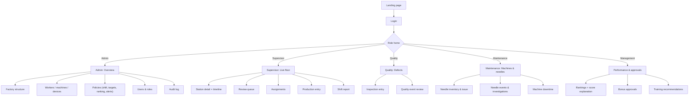
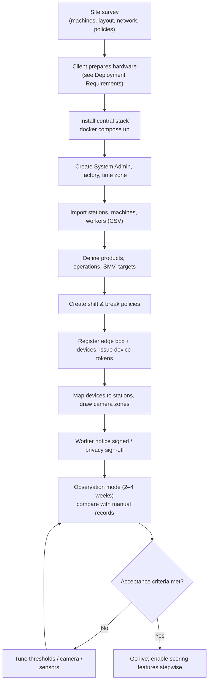
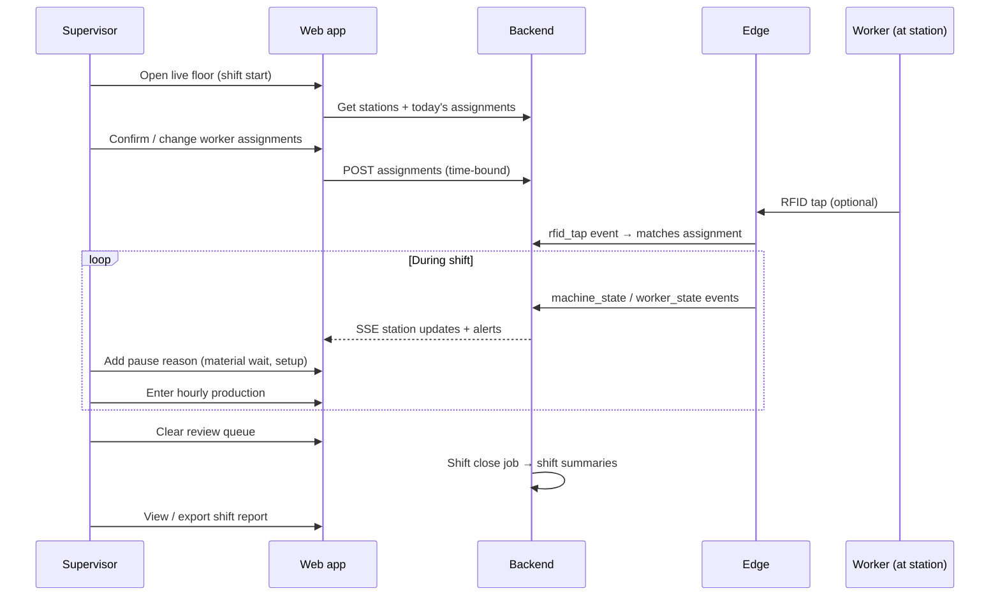
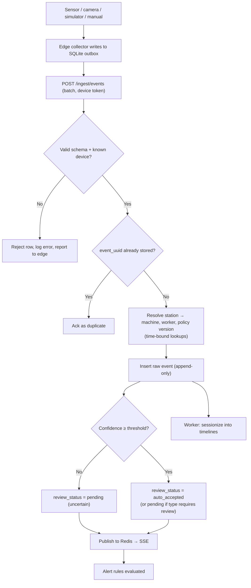
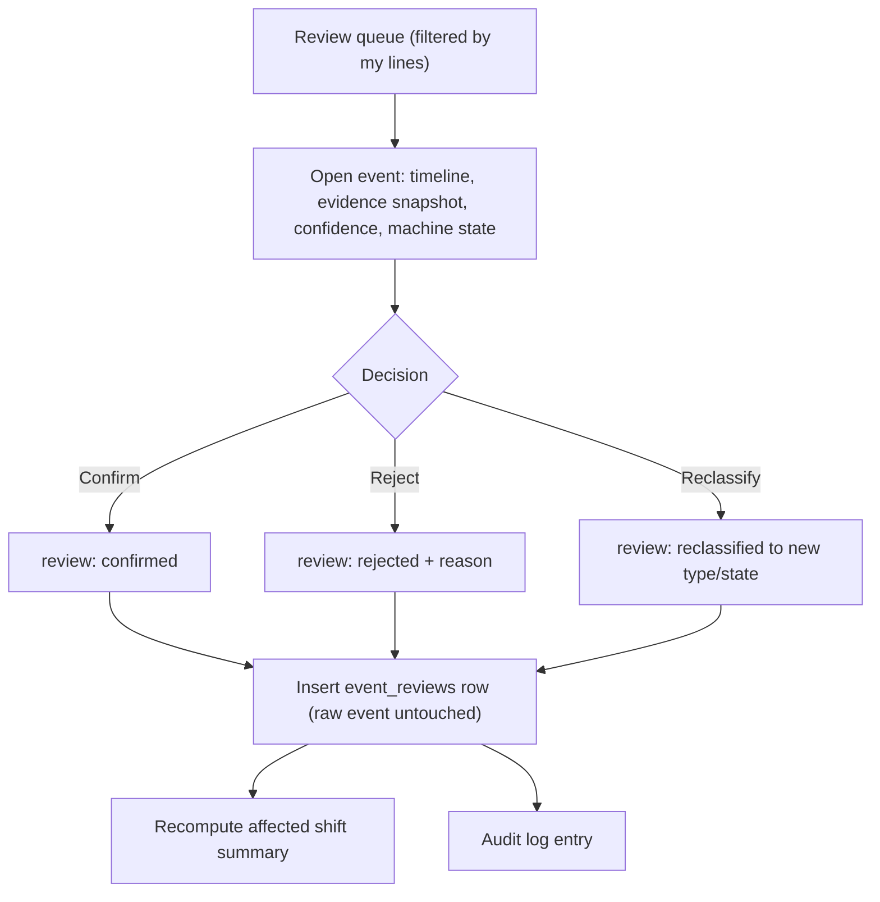
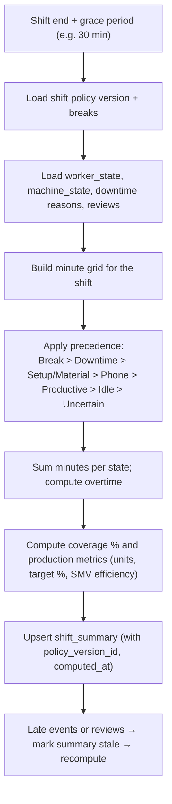
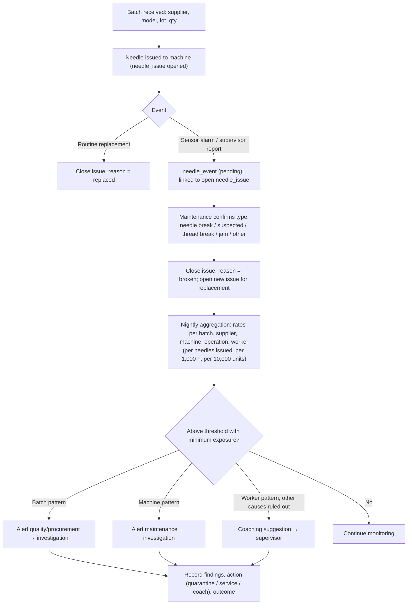
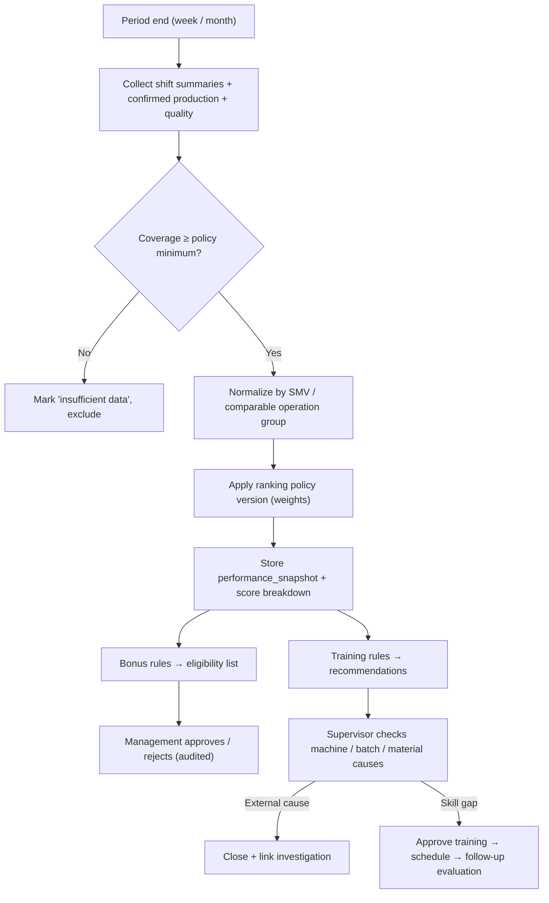
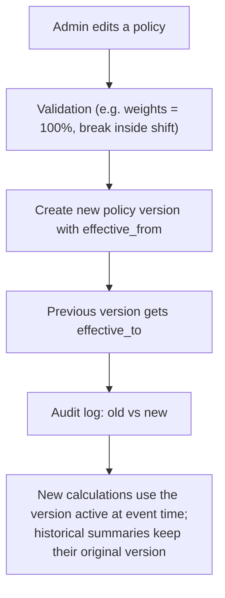
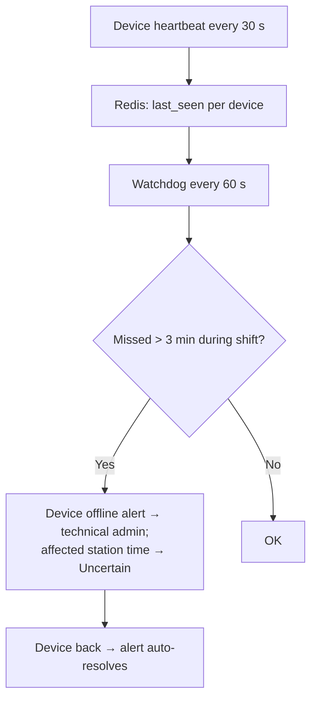

# User and System Flows

**Status:** Draft v1 — 2026-11-17
**Related:** [PRD](PRD.md) · [TRD](TRD.md) · [Backend Design](BACKEND_DESIGN.md)

Screens for each flow will be mapped once the UI design is uploaded.

---

## 1. App navigation (by role)

## 2. New client onboarding (install → go-live)

## 3. Daily shift flow (supervisor)

## 4. Event ingestion pipeline (system)

Phone-use events, needle events and quality defects always start as `pending` regardless of confidence (PRD §7.3).

## 5. Event review flow

## 6. Time accounting (shift close job)

## 7. Needle lifecycle and break investigation

## 8. Performance, bonus and training (period end)

## 9. Policy change flow

## 10. Device health

