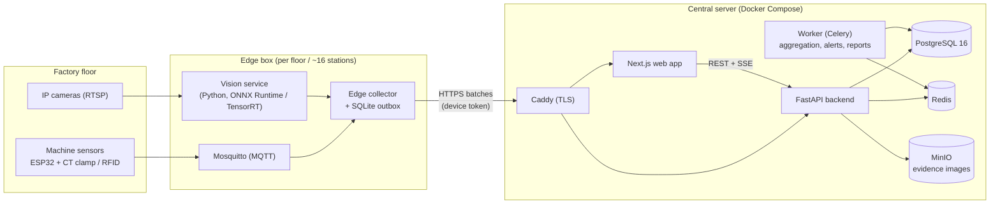

# Technical Requirements Document (TRD)

**Status:** Draft v1 — 2026-11-17
**Related:** [PRD](PRD.md) · [Flows](FLOWS.md) · [Backend Design](BACKEND_DESIGN.md) · [Deployment Requirements](DEPLOYMENT_REQUIREMENTS.md)

---

## 1. Architecture overview

Single-tenant, self-hosted per client. Two physical tiers: **edge** (on the factory floor) and **central** (client server or client-owned cloud VPS).



**Why hybrid:** factory internet is often unreliable and video is privacy-sensitive. The edge turns video into small events; only events and a few evidence snapshots travel to the central server. If the link drops, the edge buffers events in its outbox and replays them later.

For small clients, the central stack can run on the same machine as the edge box.

## 2. Technology stack

| Layer | Choice | Reason |
|---|---|---|
| Frontend | **Next.js 15 (App Router) + TypeScript**, Tailwind CSS, shadcn/ui, TanStack Query, Recharts | Mature, fast dashboards, large ecosystem |
| i18n | `next-intl` (en, bn) | Bangla support, per-user locale |
| Backend API | **Python 3.12 + FastAPI**, Pydantic v2, SQLAlchemy 2 (async), Alembic | Same language as the CV/ML stack; typed schemas; auto OpenAPI docs |
| Background jobs | Celery + Redis (beat for schedules) | Shift closing, aggregations, snapshots, alerts, reports |
| Database | **PostgreSQL 16** | Relational integrity for assignments, policies, traceability. Event tables partitioned by month. TimescaleDB is an optional add-on if event volume demands it |
| Cache / queue | Redis 7 | Celery broker, live station state, rate limiting |
| Object storage | MinIO (S3-compatible) | Evidence snapshots / clips, report exports; works on-prem |
| Live updates | Server-Sent Events from FastAPI | One-way live floor status; simpler than WebSockets |
| Edge vision | Python, OpenCV / GStreamer for RTSP, **ONNX Runtime** (TensorRT on Jetson) | Hardware-portable inference |
| Detection / pose models | Detection: **YOLOX or RT-DETR (Apache-2.0)**. Pose: MediaPipe / RTMPose (Apache-2.0) | See licensing note §8 |
| Sensor messaging | MQTT (Mosquitto) on the edge | Standard for low-cost IoT devices |
| Sensor firmware | ESP32 (Arduino / ESP-IDF) | Cheap, Wi-Fi, enough I/O for CT clamp + RFID |
| Reverse proxy | Caddy | Automatic TLS, simple config |
| Packaging | Docker + Docker Compose | One-command install per client |
| PDF reports | WeasyPrint (server-side) | HTML templates → PDF, supports Bangla fonts |
| Testing | pytest + httpx, Vitest + Testing Library, Playwright (E2E) | 80% coverage target on backend domain logic |
| CI | GitHub Actions: lint, type-check, test, build images | |

## 3. Components and responsibilities

### 3.1 Web app (Next.js)
- Public landing page (static).
- Authenticated app: dashboards per role, config screens, review queue, reports.
- Talks only to the backend API (no direct DB access). Server components fetch through the API with the user's session cookie.

### 3.2 Backend API (FastAPI)
Modules (one package per domain, see [BACKEND_DESIGN.md](BACKEND_DESIGN.md)):
`auth`, `org` (factory/floor/line/station), `workforce` (workers, assignments), `assets` (machines, devices), `policy`, `ingest`, `events` (review), `production`, `needles`, `quality`, `analytics`, `alerts`, `reports`, `audit`.

### 3.3 Worker (Celery)
- Sessionize raw events into state intervals (worker timeline, machine timeline).
- Close shifts → compute `shift_summaries`.
- Hourly production rollups.
- Needle rate aggregation + threshold checks.
- Performance snapshots (period end).
- Device heartbeat watchdog → "device offline" alerts.
- Retention purge (evidence, old events).

### 3.4 Edge collector
- Subscribes to MQTT topics from sensors.
- Receives events from the local vision service.
- Writes every event to a SQLite outbox with a client-generated UUID, then pushes batches to `POST /api/v1/ingest/events`.
- Retries with exponential backoff; marks rows sent only after a 2xx response.
- Sends heartbeat every 30 s per device.
- Pulls config (station ↔ device mapping, thresholds) from `GET /api/v1/edge/config` every 5 min.

### 3.5 Edge vision service (R3)
- One process per GPU; reads RTSP at **5 fps** for activity (enough for human motion), configurable.
- Per station: a polygon zone (set in admin UI) defines the work area.
- Pipeline: decode → detect person + phone → pose/hands → per-station state machine → emit events on **state change** only (not per frame).
- Evidence: for flagged events, save 1–3 JPEG snapshots (optional face blur) and upload via the collector.

### 3.6 Event simulator
- CLI + container (`simulator`) that generates realistic events for N stations using the same ingest API and device tokens.
- Scenarios: normal shift, long idle, phone use, machine breakdown, needle-break burst on one batch, device offline.
- Used for development, demos, and load testing.

## 4. Interfaces

### 4.1 Ingest API (edge → central)
- `POST /api/v1/ingest/events` — batch of up to 500 events.
- Auth: per-device bearer token (hashed in DB, rotatable).
- Idempotency: `event_uuid` unique; duplicates return `200` with `duplicate: true`.
- Clock: edge boxes run NTP (chrony); server rejects events more than 24 h in the future and flags events with clock skew > 5 s.

Event payload (common schema, extends source spec §15.1):

```json
{
  "event_uuid": "0f8c...-uuid",
  "event_type": "worker_state",
  "state": "phone_use",
  "station_code": "L1-S07",
  "source_device_code": "EDGE1-CAM07",
  "start_time": "2026-11-17T09:12:03.120Z",
  "end_time": "2026-11-17T09:13:41.900Z",
  "confidence": 0.87,
  "model_version": "activity-v0.3.1",
  "evidence_keys": ["evidence/2026/11/17/0f8c.jpg"],
  "metadata": { "zone": "work", "frames": 49 }
}
```

`event_type` values: `worker_state`, `machine_state`, `production_count`, `needle_event`, `quality_event`, `rfid_tap`, `device_heartbeat`.

### 4.2 MQTT topics (sensor → edge)
```
factory/{station_code}/machine/state     {"running": true, "current_a": 1.84, "ts": "..."}
factory/{station_code}/rfid/tap          {"card_id": "04A1B2...", "ts": "..."}
factory/{station_code}/needle/alarm      {"type": "break", "ts": "..."}
devices/{device_code}/heartbeat          {"fw": "1.2.0", "rssi": -61}
```

### 4.3 App API (web → backend)
REST, JSON, versioned under `/api/v1`. Response envelope:
```json
{ "success": true, "data": {}, "error": null, "meta": { "page": 1, "limit": 50, "total": 230 } }
```
Full endpoint list in [BACKEND_DESIGN.md](BACKEND_DESIGN.md#5-api).

### 4.4 Live updates
`GET /api/v1/stream/floor?line_id=...` (SSE) pushes station state changes and new alerts. Backed by Redis pub/sub.

## 5. Non-functional requirements

| Area | Requirement |
|---|---|
| Scale (per install) | Up to 500 stations, 5 factories; ~5M events / month |
| Latency | Event → dashboard ≤ 10 s (P95) on a healthy link; alerts ≤ 30 s |
| API performance | Dashboard queries P95 ≤ 800 ms on 12 months of data |
| Offline tolerance | Edge buffers ≥ 72 h of events locally |
| Availability | Central app 99% during shift hours; health endpoint `/healthz` |
| Data integrity | Raw events are append-only; reviews are separate records; policies versioned |
| Time | All timestamps stored UTC (`timestamptz`); displayed in factory time zone (default `Asia/Dhaka`, configurable) |
| Security | See §6 |
| Backup | Nightly `pg_dump` + MinIO sync to off-site storage; restore tested before go-live |
| Observability | Structured JSON logs, request IDs, Prometheus metrics endpoint (optional Grafana) |
| Upgrades | Versioned Docker images; Alembic migrations run on deploy; rollback = previous image + DB backup |
| Accessibility | WCAG 2.2 AA for core screens |
| Browsers | Latest Chrome / Edge / Firefox; tablet layout for supervisors on the floor |

## 6. Security

- Passwords hashed with Argon2id; lockout after 10 failed attempts.
- Sessions: httpOnly, Secure, SameSite=Lax cookies; CSRF token for mutating requests.
- RBAC enforced in the API on every endpoint (not only in UI), plus factory/line scoping.
- Device tokens separate from user auth; scoped to ingest + edge config only.
- TLS everywhere (Caddy). Internal network for DB / Redis / MinIO (not exposed).
- Evidence files served through short-lived signed URLs; every access audited.
- Secrets via `.env` file outside the repo; required secrets validated at startup.
- Rate limiting on login and ingest endpoints.
- Dependency scanning in CI (pip-audit, npm audit).

## 7. Computer vision requirements (R3+)

| Module | Input | Output | Validation target |
|---|---|---|---|
| Presence | Station zone, 5 fps | present / absent | ≥ 98% accuracy |
| Activity | Pose + hands in zone + machine state | working / not working / uncertain | ≥ 85% vs reviewed samples |
| Phone use | Detection (phone) + hand/head pose, min duration | probable phone-use event | precision ≥ 90% |
| Seam inspection (R4) | Close-up fixed camera + controlled light | defect class + confidence | Defined during pilot |

- Every model has a version string; events store it.
- Thresholds live in policy config, not in code.
- A labeled validation set per client (from pilot footage with consent) is required before enabling a model in "active" mode. Before that, models run in **observation mode** (events stored, hidden from scores).

## 8. Licensing constraints

The product is sold commercially and installed at client sites, so all bundled components must allow that.
- **Do not bundle Ultralytics YOLOv5/v8/11** without buying its enterprise license (it is AGPL-3.0).
- Prefer Apache-2.0 / MIT / BSD models and libraries: YOLOX, RT-DETR (PaddleDetection / HF implementations), MediaPipe, RTMPose (MMPose), ONNX Runtime.
- Keep a `THIRD_PARTY_LICENSES` file generated in CI.

## 9. Repository layout (monorepo)

```
/apps/web            Next.js frontend
/apps/api            FastAPI backend (domain packages under app/modules/*)
/apps/worker         Celery tasks (shares api package)
/edge/collector      Edge collector service
/edge/vision         Vision service (R3)
/edge/firmware       ESP32 firmware
/tools/simulator     Event simulator
/deploy              docker-compose files, Caddyfile, .env.example, install scripts
/docs                PRD, TRD, flows, backend design, deployment requirements
```

## 10. Environments

| Env | Where | Data |
|---|---|---|
| Local dev | Docker Compose on developer laptop | Seed + simulator |
| Demo | Cloud VPS | Seed + simulator, reset nightly |
| Client pilot | Client edge + central | Real, observation mode |
| Client production | Client edge + central | Real |
